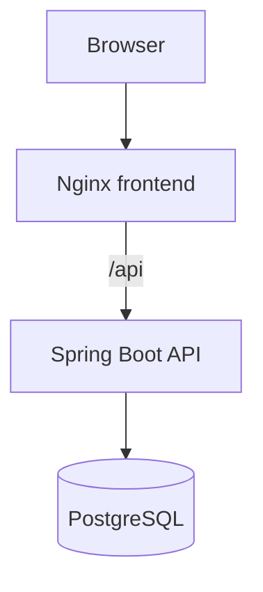
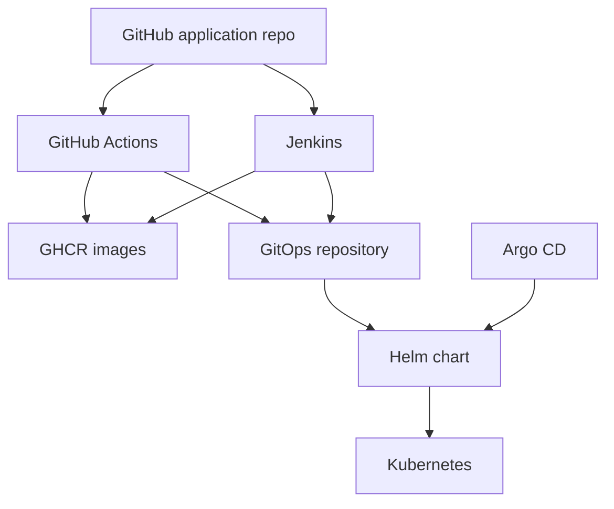

# Task Manager — DevOps & DevSecOps Portfolio Project

A containerized monolithic task-management application used to demonstrate CI automation, container image delivery, GitOps deployment configuration, Kubernetes resources, and Terraform.

> **Accuracy note:** The files inspected confirm configuration. They do not, by themselves, prove that every pipeline, cluster deployment, or infrastructure operation is currently running. Add genuine screenshots and command output before claiming successful runtime deployment.

## Project overview

The application consists of:
- React + Vite frontend served by Nginx.
- Spring Boot REST API running on Java 21.
- PostgreSQL 16 database.

The application repository is separate from the GitOps repository. Two alternative CI implementations are configured: GitHub Actions and Jenkins. They are not inherently sequential parts of one pipeline.

## Architecture


### Application



### CI and GitOps



## Technology stack

| Area | Tools |
|---|---|
| Frontend | React, Vite, Node.js 22, Nginx |
| Backend | Java 21, Spring Boot, Maven |
| Database | PostgreSQL 16 |
| Containers | Docker, Docker Compose |
| CI | GitHub Actions, Jenkins |
| Security | Gitleaks, Trivy |
| SBOM | CycloneDX via Trivy |
| Registry | GitHub Container Registry |
| CD / GitOps | Helm, Argo CD |
| Kubernetes networking | Gateway API |
| IaC | Terraform, AWS provider |

## Local development

Prerequisites: Docker Desktop installed and running.

```bash
docker --version
docker compose version
```

Create a local `.env` file in the repository root. Do not commit it.

```dotenv
DB_NAME=taskdb
DB_USERNAME=postgres
DB_PASSWORD=replace-with-local-password
POSTGRES_USER=postgres
POSTGRES_PASSWORD=replace-with-local-password
VITE_API_URL=http://localhost:8080
```

Keep `DB_USERNAME`/`DB_PASSWORD` consistent with `POSTGRES_USER`/`POSTGRES_PASSWORD`.

```bash
docker compose up --build
```

Endpoints:
- Frontend: http://localhost:3000
- Backend health: http://localhost:8080/api/health
- PostgreSQL host port: 5433 (container port 5432)

Useful commands:

```bash
docker compose ps
docker compose logs -f
docker compose logs -f backend
docker compose down
```

`docker compose down -v` also deletes the named database volume and its local data. Use it only when that is intended.

The backend waits for PostgreSQL health. The frontend waits for the backend container to start, which does not guarantee the API is ready; a backend health check and `service_healthy` dependency would improve startup reliability.

## GitHub Actions

Workflow: `.github/workflows/ci.yml`

Triggers: pushes and pull requests to `main` and `develop`, plus manual dispatch.

Configured workflow:
1. Backend verification using Temurin Java 21 and `mvn clean verify`.
2. Frontend build using Node.js 22, `npm ci`, and `npm run build`.
3. Gitleaks secret scan.
4. Trivy filesystem scan for vulnerabilities, secrets, and misconfigurations at HIGH/CRITICAL severity.
5. Build frontend and backend Docker images.
6. Trivy image scans.
7. Generate CycloneDX SBOMs and upload them as artifacts.
8. Tag images with the Git commit SHA and push to GHCR.
9. Update image tags in the separate GitOps repository.

The filesystem scan uses `exit-code: 1`, so configured findings can fail the job. The image scan steps use `exit-code: 0`, so they report findings but do not currently block the pipeline. The GitOps update requires a GitHub secret named `GITOPS_TOKEN`. GHCR publishing uses `GITHUB_TOKEN` with package write permission.

## Jenkins

Pipeline: `Jenkinsfile`; custom Jenkins image definition: `Dockerfile.jenkins`.

Configured stages:
1. Checkout.
2. Environment check.
3. Backend tests (`mvn test`).
4. Frontend install/build (`npm ci`, `npm run build`).
5. Build backend and frontend Docker images.
6. GHCR login using Jenkins credential ID `ghcr-creds`.
7. Push build-number and `jenkins` tags.
8. Verify local images.
9. Update and push GitOps Helm image tags.

Jenkins also expects credential ID `gitops-creds`. Store credentials in Jenkins Credentials; never commit their values. The inspected Jenkinsfile does not contain the Gitleaks, Trivy, or SBOM stages present in GitHub Actions.

## Container registry

Configured repositories:
- `ghcr.io/ashwin1808/task-manager-backend`
- `ghcr.io/ashwin1808/task-manager-frontend`

GitHub Actions uses the full Git commit SHA as image tag. Jenkins uses the build number and also publishes a `jenkins` tag.

## GitOps and Argo CD

Separate repository: https://github.com/Ashwin1808/task-manager-gitops

`argocd/task-manager.yaml` configures:
- Application `task-manager` in namespace `argocd`.
- Source branch `main`, path `helm/task-manager`.
- Destination namespace `task-manager`.
- Automated sync, prune, and self-heal.
- `CreateNamespace=true`.

Expected flow:
1. CI builds and publishes images.
2. CI updates image tags in GitOps.
3. Argo CD observes the Git change.
4. Argo CD reconciles Helm-rendered desired state with Kubernetes.

The manifest proves intended configuration, not live health. Capture Argo CD `Synced` and `Healthy` status before claiming a successful deployment.

## Kubernetes and Helm

The Helm chart is in `helm/task-manager` in the GitOps repository. Inspected configuration includes:
- Backend initial replicas: 2.
- Frontend replicas: 1.
- Backend HPA: min 2, max 5, CPU target 70%.
- Backend scale-down stabilization: 300 seconds.
- Backend and frontend resource requests and limits.
- RollingUpdate strategy: `maxSurge: 1`, `maxUnavailable: 0`.
- Backend readiness/liveness probes against `/api/health`.
- Frontend readiness/liveness probes against `/`.
- PostgreSQL 16 Alpine and a 1 GiB PVC.
- GHCR image pull secret reference `ghcr-secret`.

Gateway API configuration:
- Gateway class `eg`, HTTP listener on port 80.
- `/api` routes to `task-manager-backend:8080`.
- `/` routes to `task-manager-frontend:8080`.

Gateway resources require compatible Gateway API CRDs and a controller. YAML presence alone does not prove the route is programmed.

Validation commands:

```bash
helm lint helm/task-manager
helm template task-manager helm/task-manager -n task-manager
kubectl get applications -n argocd
kubectl get deployments,services,pods -n task-manager
kubectl get hpa,pvc -n task-manager
kubectl get gateway,httproute -n task-manager
```

## Terraform

The GitOps repository has Terraform configuration under `terraform/`. The AWS provider is configured with test credentials, skips several AWS credential/account metadata checks, and overrides the S3 endpoint to `http://localhost:4566`. It declares an S3 bucket named `ashwin-task-manager-terraform-state-demo`.

This is configured for a local AWS-compatible endpoint, not proof of provisioning in a real AWS account.

Important: declaring an `aws_s3_bucket` resource does not configure Terraform remote state. A remote backend requires an explicit `backend` block and initialization.

The Terraform `.gitignore` excludes `.terraform/`, `*.tfstate`, `*.tfstate.*`, crash logs, and variable files. Keep state and secret-bearing files out of Git.

## Security and known improvements

1. Helm values inspected during the audit contained the placeholder database password `change-me`. Replace it with secure secret injection before any real deployment.
2. GitHub Actions image scans currently use `exit-code: 0`; decide whether findings should block image publishing and configure enforcement accordingly.
3. Gateway API YAML files were untracked in the local GitOps working tree during the audit. Validate and commit them if they are intended to be part of the shared deployment source.
4. Terraform state was not listed by `git ls-files` during the audit. Keep it ignored.
5. Compose frontend dependency waits for backend container start, not API readiness.
6. Add Prometheus/Grafana documentation only after confirming the actual manifests, configuration, and runtime evidence.

## Evidence to add

Create `docs/screenshots/` and add genuine, sanitized evidence for:
- Successful GitHub Actions workflow.
- Successful Jenkins build.
- GHCR packages and image tags.
- GitOps commit showing image tag update.
- Argo CD `Synced` / `Healthy` status, if verified.
- Kubernetes workloads, HPA, PVC and Gateway status, if verified.
- Terraform plan/apply against the local endpoint, if verified.
- Monitoring dashboards only if configured and running.

Never fabricate green pipeline screenshots, deployment status, scan results, cloud resources, or monitoring metrics.

## Repository layout

Application repository:

```text
.
├── .github/workflows/ci.yml
├── backend/
├── frontend/
├── docker-compose.yml
├── Dockerfile.jenkins
├── Jenkinsfile
└── README.md
```

GitOps repository:

```text
task-manager-gitops/
├── argocd/task-manager.yaml
├── helm/task-manager/
│   ├── Chart.yaml
│   ├── values.yaml
│   ├── gateway.yaml
│   ├── gatewayclass.yaml
│   ├── httproute.yaml
│   └── templates/
└── terraform/
```

## Repositories

- Application: https://github.com/Ashwin1808/Demo-Tasts
- GitOps: https://github.com/Ashwin1808/task-manager-gitops
