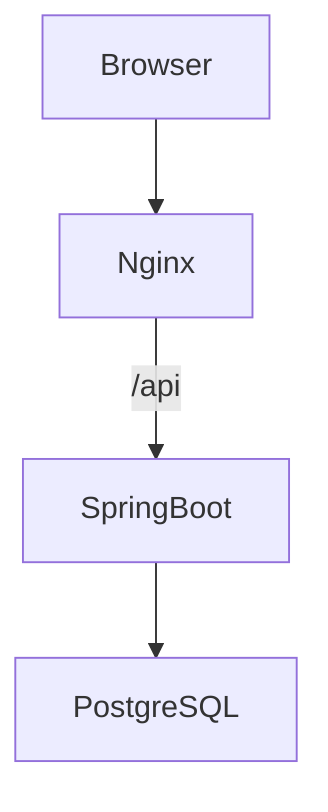
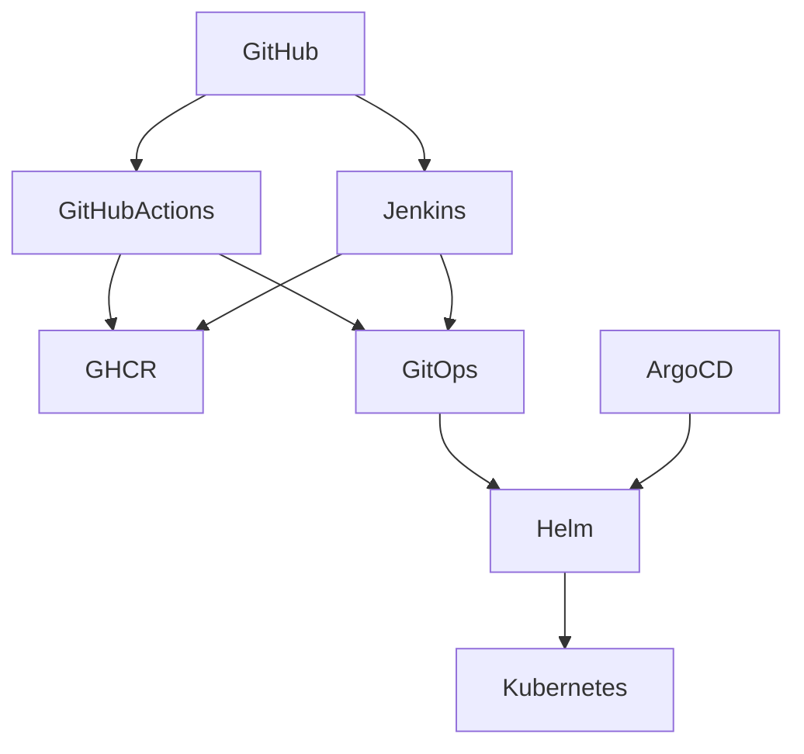

# Architecture

## Application

## CI and GitOps

GitHub Actions and Jenkins are alternative CI implementations. Argo CD is configured to watch the GitOps repository and reconcile the Helm application.
